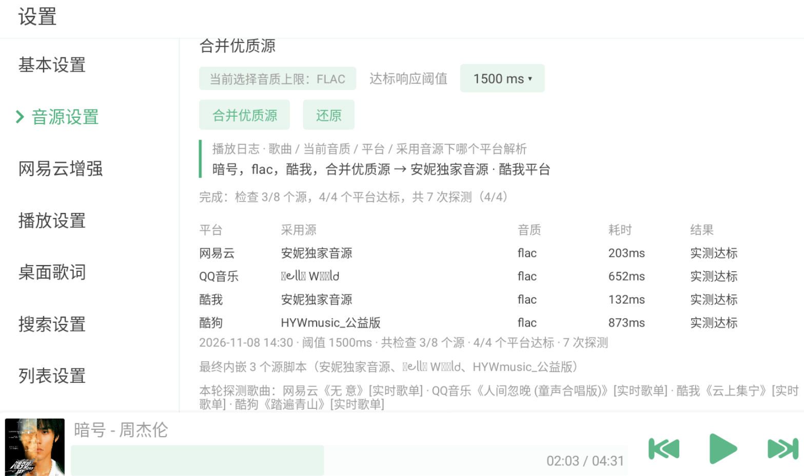

<div align="center">

# LX-Music Plus

**一个更好用的洛雪音乐安卓版，自动挑选所有自定义音源下的最优质平台解析路线，合并成一个新的源使用。添加网易云功能模块，添加部分原版没有的功能。增加车机专属优化，去除更新，永久养老**

</div>

---

## 这是个什么软件

**它是在原版&#x20;**[**LX Music 移动版**](https://github.com/lyswhut/lx-music-mobile)**&#x20;基础上改的。定位：修改和优化原版 LX Music 中不合理、功能缺失的地方，并在不破坏原有体验的前提下，增加或恢复新旧功能。**

原版能用，但有几件事挺折腾：

- 单一音源可能网易云平台好用，QQ平台不好用，酷我平台的歌甚至无法解析。没有完美的四平台都好用的单一源。
- 一家音源慢了或者失效了，一首歌能卡很久，甚至直接放不出来；
- 无网易云账号相关的东西（每日推荐、我的歌单）；

这个版本主要做三件事：**让播放歌曲这件事不用因为音源烧心、把播放歌曲做到点击就播丝般顺滑、把网易云账号功能补齐**。用不上的功能也干脆不做，比如没有下载。

## 和原版比，改了什么

| 事情           | 原版               | 这个版本                                  |
| ------------ | ---------------- | ------------------------------------- |
| 音源           | 自己找、自己加          | 装好就自带 8 个2026年11月8日发布时最优质能用的；你自己加的都保留 |
| 某家音源卡住       | 一首歌慢慢等           | 一发现不行，就同时问另外几家，谁先给能播的链接就用谁            |
| 一家音源不是每个平台都快 | 只能整体换一家          | **每个平台各挑最快的一家**，自动合成一个音源来用（下面细讲）      |
| 网易云账号        | 没有               | 扫码登录、每日推荐、我的歌单、自己上传到网盘的歌、评论和红心都能用     |
| 歌手 / 专辑页面    | 只有网易云            | 网易云、QQ 音乐、酷我、酷狗四家都能看                  |
| 车机横屏界面优化     | 歌曲列表通常只能显示3行6首歌曲 | 现在可以显示5-6行10-12首                      |

## 有哪些功能

**听歌更稳**

- 装好自带 8 个github社区音源，第一次打开默认用一个靠谱的，之后你换了就尊重你的选择。
- 拿到播放链接会先快速确认一下是不是真能播，不是网页或错误提示；碰到「不确定」的情况会放行，不误杀。
- 播放出错时不再反复试同一个坏链接，而是换一家音源重新找。

**一键挑出最好用的音源**

- 点一下「合并优质源」，软件自动帮你测当前自定义源列表内的所有源，给四个音乐平台各挑一家最快的，最后合成一个音源直接用。
- 觉得多快算「快」可以自己调，半秒到三秒都行。默认1000ms。
- 随时可以点「还原」换回原来的音源。
- **所以，日常使用，当你发现上次的合并音乐源有某个平台的歌曲不能解析时，重新回设置点击一次，5秒钟新的最优质路线源就生成了。**
- **其实这个模块也可以做成软件开启自检，考虑性能占用和频繁的开启关闭重复加载才做成了按钮。**

**网易云账号能用了**

- 扫码登录、在网页里登录，或者手动粘贴一串登录信息（设置里叫 Cookie）都行，支持多账号。
- 每日推荐、我的歌单、歌单里的歌曲、评论、红心。
- 自己上传到网易云网盘的歌也能播；登录后打开过的歌单会存在手机里，即使登录状态失效时还能看，还能播
- 登录信息**只用来读你的歌单和播账号网盘（网盘歌曲无法解析）里的歌**，其他歌曲的播放通通走解析路线。

**四家平台的歌手和专辑**

- 网易云、QQ 音乐、酷我、酷狗的歌手页、专辑页都能打开；查不到就自动按名字搜。

**界面和小细节**

- 详情页返回更顺，横屏竖屏都不打架；在播放页看详情时，底部的播放条一直都在。
- 针对车机横屏特调：竖屏一行高一点、横屏密一点，横屏能两列显示更多歌。
- 菜单里删掉了用不上的「分享歌曲」和多余的「播放」，歌手、专辑入口挪到更顺手的位置。

**少一点碍事的东西**

- 没有下载功能（2026年不要下载了，直接在线听吧，设置入口隐藏，后台代码保留，需要的话自己加。）。
- 关掉了版本更新检查，也不再加每次听歌都同时问好几家的做法——合并好音源之后没必要。
- 删掉了多余的统计面板和说明文字。
- 删掉了我日常使用中用不到的功能和界面设置，但是代码都保留在后台，需要自己下载项目让AI打开。

## 「合并优质源」到底是怎么做的

先说清楚难在哪：**每家音源擅长的平台不一样**。A 家拿网易云的歌特别快，B 家拿酷狗的稳，C 家拿 QQ 音乐能出好音质。可你一次只能选一家，选了 A，就得连它在酷狗的慢速度一起忍着。而且软件有个规矩——**同一时间只认一家音源**，硬挂好几家只会互相打架，最后还是只有一家起作用。

我们的办法像「分组考试」：

1. **出题**：给网易云、QQ 音乐、酷我、酷狗各从真实排行榜里随机挑一首歌，这一轮所有音源都做同一套题，公平。偶尔榜单没抓到，就用软件里备好的歌。
2. **定标准**：你选好想要的音质（比如无损），再定一个「多久算快」的时间，默认 1 秒，可以调成 0.5 秒到 3 秒。
3. **一家一家考**：按你列表里的顺序试。用你选的音质去问，能在规定时间内给回一个能播的链接，就算这家在这个平台「过关」。
4. **过了就不再考**：某个平台已经找到合适的，后面的音源就不用再测它；四个平台全齐了立刻收工。所以常常试到第 3 家就结束了。
5. **合成一家**：把过关的几家最拿手的部分抄进同一张「通讯录」——歌是网易云的就找 A，是酷狗的就找 B。软件里看起来只用了一个音源，其实每个平台都派给了最合适的那家。万一某个平台谁都没过关，会用列表里第一家顶上，保证四个平台都有得用。

几个要留个心眼的地方：

- 「过关」只是说**答得够快、链接能用**，不代表音质更好；音质是你自己在播放设置里选的音质上限。
- 先过关的不一定是全场最快，只是按你源列表顺序先遇到的。图的是少折腾，不是把每一家都比一遍。
- 结果只代表**当时测出来的情况**。以后音源自己更新或者失效了，再点一次合并就好。
- 测试过程中会临时切换音源，可能打断正在放的歌，点开始前会提示你。

## 看图说话



这是「设置 → 音源设置」里一次真实的合并结果：

- **左边**是新增的「音源设置」，单独一栏，不用再翻基本设置。
- **最上面**：「当前选择音质上限：FLAC」是你在播放设置里选的音质，这里只是提醒；「达标响应阈值 1500 ms」是这次「多快算过关」的标准，可以点开改。
- **两个按钮**：「合并优质源」开始测（测的时候会变成「取消合并」），「还原」换回原来的音源。
- **绿色竖条那一行**是播放日志，只留最近一条。图里意思是：正在放《暗号》，无损音质，这首歌属于酷我；合并音源把它派给了「安妮独家音源」这家来处理酷我平台。
- **「检查 3/8 个源，4/4 个平台达标，共 7 次探测」**：一共 8 家候选，只试到第 3 家四个平台就都齐了，前后一共问了 7 次，所以早早收工。
- **中间的表格**：四个平台分别用了哪一家、花了多少毫秒（203 / 652 / 132 / 873），结果都是「实测达标」。可以看到网易云和酷我用的是同一家，另外两个平台各用一家。
- **最下面**：这次拿哪几首歌当考题、最后把哪 3 家写进了合成音源，都写得清清楚楚。
- **底部播放条**照常工作，测音源不影响听歌。

## 日常使用

- 合并结果是当时测出来的，不会自动跟着音源更新；音源大面积失效后重新合并一次就行。如果当前内置8个源都失效了，就更新自定义源。下面推荐两个项目获取源
- <https://zlyon.github.io/lx-hub/>
- <https://github.com/guoyue2010/lxmusic->
- 两个项目中一键下载音乐源，导入洛雪，然后点击我们的合并优质源即可生成最优质路线的解析源。
- 后续可能会考虑增加自动下载音源导入功能，做到真正永久养老，无需找源。技术层面不难，主要是GITHUB经常无法直连。

## 怎么装

到 [Releases](../../releases) 下载名字里带 `arm64-v8a` 的安装包，现在的安卓手机基本都是这一类。

- 它和原版用的是**同一个名字，但安装凭证不同**：不能直接盖在原版上，装之前要先把官方原版卸掉；两个软件的数据也不互通。
- 支持安卓 5.0 以上，只有安卓版，没有 iOS 版。
- 装好打开就自带音源，建议去「音源设置」点一次「合并优质源」，按你自己的网络挑一遍。

## 想自己编译（给懂开发的朋友）

需要 JDK 17（用更高版本会卡在自动下载上）、安卓 SDK Platform 36 / Build-Tools 35 / NDK 26。

```bash
npm ci
cd android
./gradlew assembleRelease -PreactNativeArchitectures=arm64-v8a
```

Windows 用 `gradlew.bat`，安装包在 `android/app/build/outputs/apk/release/`。原版自带的自动构建流程已挪到 `doc/upstream-workflows/` 不再触发，需要的话请先配好签名信息再放回去。

## 来源与感谢

- 基于 [lyswhut/lx-music-mobile](https://github.com/lyswhut/lx-music-mobile)（Apache-2.0），原版版权归原作者和贡献者所有，本版本的修改同样免费开源。[原版说明](./doc/README-upstream.md) · [许可协议](./LICENSE)
- 内置的 8 个音源来自公开社区，版权归各自作者。

本项目仅供学习研究，**不提供任何歌曲，也不提供找歌服务**；音乐版权归各平台和版权方，请支持正版。使用第三方音源带来的后果由使用者自行承担。软件完全免费，不接受商业合作与捐赠。

---

<sub>想看每个版本改了什么：[CHANGELOG-LXN.md](./CHANGELOG-LXN.md) · 想看「合并优质源」的实现细节（给开发者）：[技术说明](./doc/merge-sources-technical.md)</sub>
